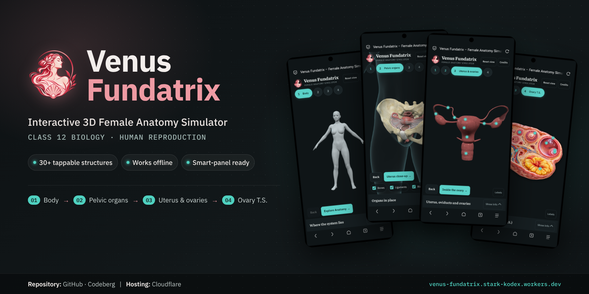
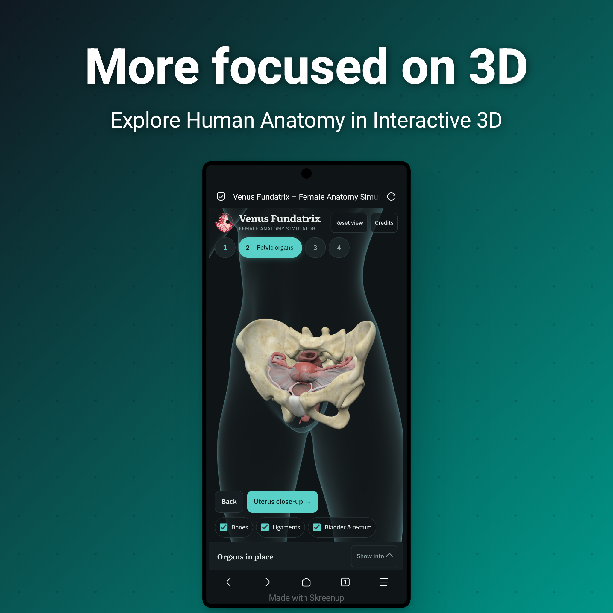

  

<h1 align="center">Venus Fundatrix</h1>

<em>Interactive 3D Female Anatomy Simulator</em>

<a href="https://venus-fundatrix.stark-kodex.workers.dev/"><strong>Explore the Anatomy</strong></a>

  <a href="#about">About</a> ·
  <a href="#screenshots">Screenshots</a> ·
  <a href="#stages">Stages</a> ·
  <a href="#controls">Controls</a> ·
  <a href="#technology">Technology</a> ·
  <a href="#credits">Credits</a> ·
  <a href="#license">License</a>

<em>Project dedicated to Lord Vishnu</em>

---

## About

An interactive 3D simulator of the female reproductive system. It starts with the whole body and moves inward, stage by stage, to a transverse section of the ovary. Students tap organs, ligaments and bones to read about each one.

Built for classroom smart panels. All models are bundled, so it also runs offline from a folder or pen drive.

---

## Screenshots

<table width="100%">
  <tr>
    <td width="50%" align="center">
      
       <b>1 · Body</b>
    </td>
    <td width="50%" align="center">
      
       <b>2 · Pelvic Organs</b>
    </td>
  </tr>
  <tr>
    <td width="50%" align="center">
      
       <b>3 · Uterus and Ovaries</b>
    </td>
    <td width="50%" align="center">
      
       <b>4 · Ovary T.S.</b>
    </td>
  </tr>
</table>

---

## Stages

| Stage | What You See | Tap to Explore |
|:--|:--|:--|
| **1 · Body** | Where the system lies in the pelvic cavity | — |
| **2 · Pelvic Organs** | Organs in place inside the bony pelvis, with bladder and rectum | Organs · Six ligaments · Bladder and rectum · Hip bones and sacrum |
| **3 · Uterus and Ovaries** | Anteverted uterus with oviducts curving to the ovaries | Fundus · Body · Cervix · Vagina · Infundibulum · Ampulla · Isthmus · Ovary · Ovarian ligament |
| **4 · Ovary T.S.** | Section through the ovary | Germinal epithelium · Cortex · Medulla · Follicle stages · Antrum · Secondary oocyte · Zona pellucida · Corpus luteum |

**Concepts:** pelvic anatomy · ligament support · reproductive tract · uterine wall · ovarian stroma · follicle development · oogenesis · corpus luteum and progesterone

---

## Controls

| Control | Function |
|:--|:--|
| Drag · Pinch or scroll | Rotate · Zoom |
| Tap a part or dot | Open its info card |
| Back · Next · Stage buttons | Move between stages |
| Show layers | Hide bones, ligaments, or bladder and rectum (stage 2) |
| Labels | Show or hide label dots (stages 3 and 4) |
| Reset view · Full screen · Credits | View and app options |

---

## Technology

HTML · CSS · JavaScript · Three.js r160 · three-mesh-bvh · Cloudflare Pages

<b>Project files</b>

| File | Contents |
|:--|:--|
| `index.html` | Page structure |
| `style.css` | Styling |
| `app.js` | App logic, with Three.js and three-mesh-bvh bundled |
| `assets.js` | 3D models and images (base64), for offline use |

---

## Credits

| Contributor | Role |
|:--|:--|
| **Sai Prasad**, M.Sc. Agri. Entomology, ASRB NET | Project Designer |
| Claude Opus 5.5 | Development |
| OpenAI GPT Luna 5.7 | Image Generation |
| Perplexity Sonar 2 | Scientific Reasoning |

<b>3D models</b>

| Asset | Model | Creator | Licence |
|:--|:--|:--|:--|
| Female body | [Women/Female body base rigged](https://sketchfab.com/3d-models/womenfemale-body-base-rigged-45caea510e4b4b65bf4ef9bbb4d2045c) | camilooh | CC BY 4.0 |
| Pelvis and organs | [adult female reproductive system](https://sketchfab.com/3d-models/adult-female-reproductive-system-94c38b5191324bc1ae1e87974cfdba58) | Education Resource Fund | CC BY 4.0 |
| Uterus and ovaries | [Uterus](https://sketchfab.com/3d-models/uterus-0c543295600d4feaa3bf723cc1bb1730) | Beste Zengin | CC BY 4.0 |
| Ovary T.S. | Ovary TS Illustration | Sai Prasad | AI-generated (OpenAI GPT Luna 5.7) |

Models were fitted together, resized and labelled for this simulator. Original creators retain ownership. [CC BY 4.0](https://creativecommons.org/licenses/by/4.0/)

<b>Libraries and fonts</b>

| Component | Licence |
|:--|:--|
| Three.js r160 · three-mesh-bvh | MIT |
| Literata · IBM Plex Sans · IBM Plex Mono | SIL Open Font License 1.1 |

---

## Releases

| Release | Title | Date |
|:--|:--|:--|
| RC X | Final Release | 19 Oct 2026 |

---

## License

Source code: **MIT License** (see [LICENSE](LICENSE)). 3D models keep their own licences.

GitHub · Codeberg &nbsp;|&nbsp; Hosted on Cloudflare Pages

