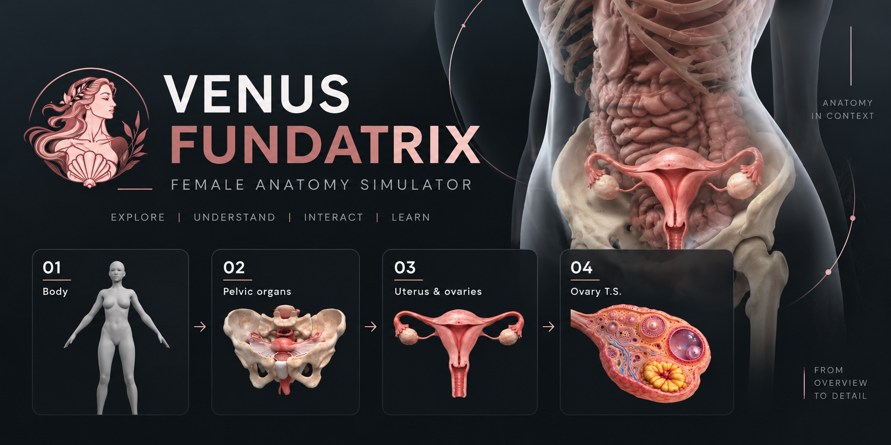
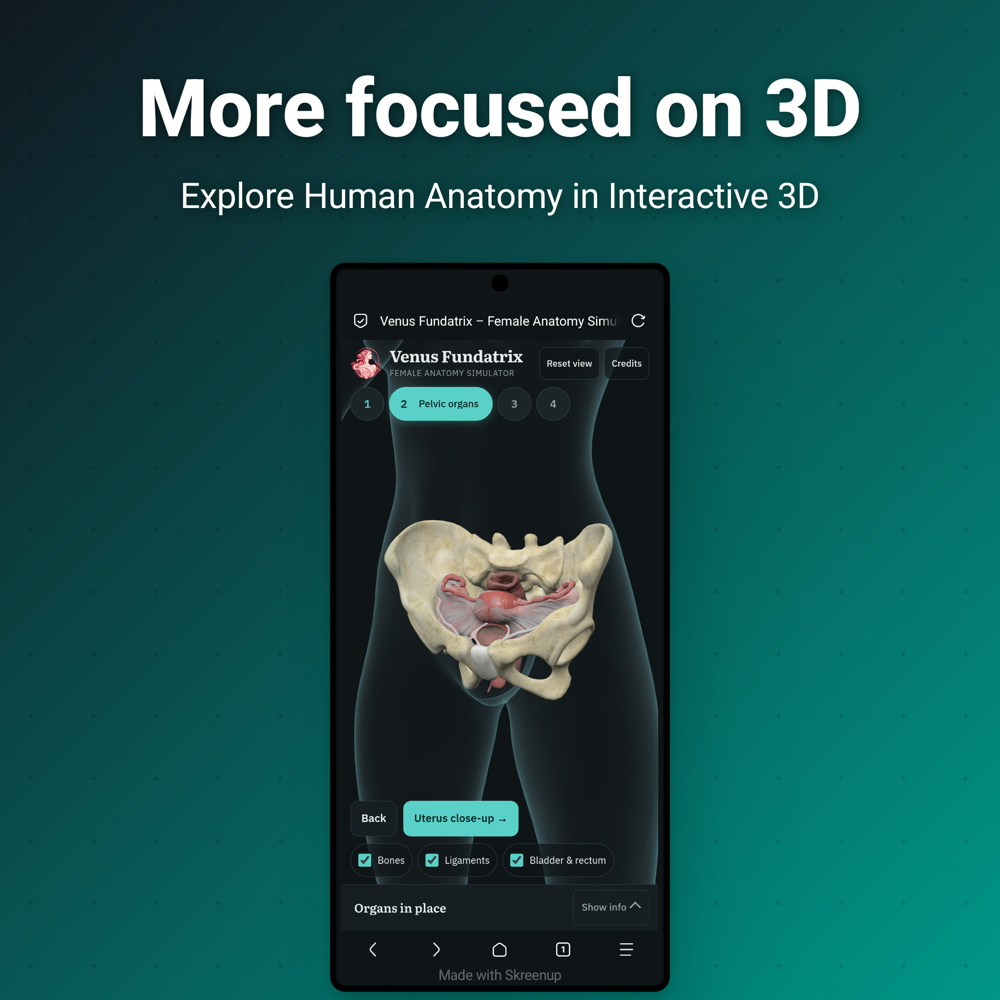

  

<h2 align="center">Venus Fundatrix</h2>
<strong>Interactive 3D Female Anatomy Simulator</strong>

  
>Explore female reproductive anatomy through detailed 3D models and interactive anatomical visualization.

  <a href="https://venus-fundatrix.stark-kodex.workers.dev/"><strong>Explore the Simulation →</strong></a>

---

<em>Project Dedicated to Lord Vishnu
</em>

---

🔸 **Features**

- 3D Anatomical Visualization : Explore reproductive structures through interactive 3D models.
- Pelvic Anatomy : Examine the spatial relationships between pelvic organs.
- Uterine & Ovarian Anatomy : Explore key structures of the female reproductive system.
- Ovarian Cross-Section : Visualize internal ovarian structures.
- Animated Transitions : Navigate smoothly between anatomical views.
- Integrated 3D Models : Combine anatomical assets into a cohesive learning experience.

---

🔸 **Learning Objectives**

Develop an understanding of female reproductive anatomy, organ relationships, and ovarian structure through interactive visualization.

---

🔸 **Technology**

- HTML5
- CSS3
- JavaScript
- 3D Models & Animation

---

🔸**Screenshots**

Explore the key views of Venus Fundatrix, from full-body anatomy to detailed reproductive structures.

**1. Full-Body Anatomy**

  
  

**2.Pelvic Anatomy**

  
  

**3. Uterus & Ovaries**

  

**4. Ovarian Cross-Section**

  

---

🧩 **3D Model Credits**

• Sketchfab models (CC BY 4.0), adapted for Venus Fundatrix, plus an AI-generated ovarian cross-section.

🔸 Female Body — "camiloVenus Fundatrix. The ovarian cross-section was AI-generated.

🔸 Female Body — "camilooh" (SKETCHFAB_SOURCE_URL) · CC BYL) · CC BY 4.0

🔸 Uterus & Ovaries — "bz_ medical modeling and animation" (SKETCHFAB_SOURCE_URL) · CC BY 4.0

🔸 Ovary Cross-Section: By Draven Ashcroft · AI-generated using OpenAI 5.7

---

🔸 **License**

Licensed under the "MIT License" (LICENSE).
